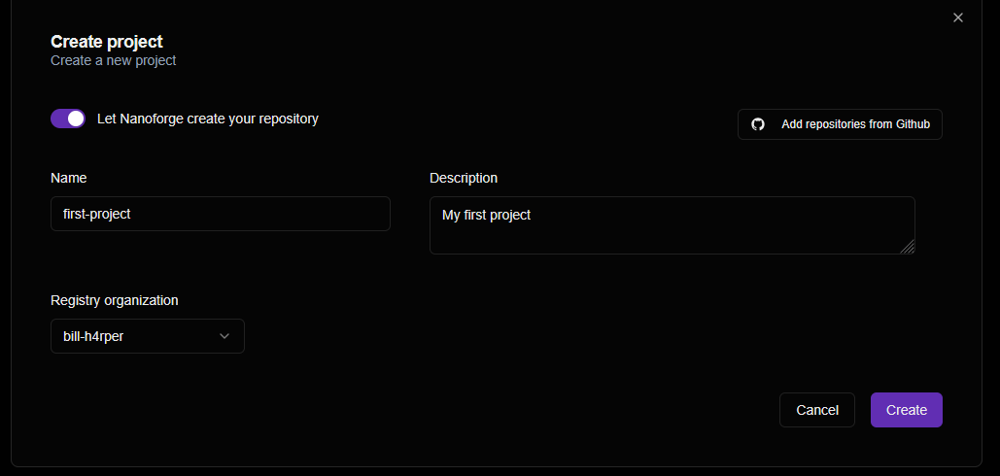
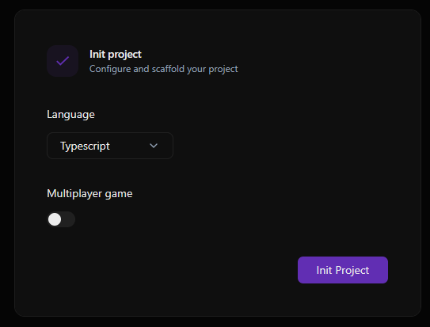

You can use the editor in two ways:

- **Hosted**, at [editor.nanoforge.eu](https://editor.nanoforge.eu): nothing to install, and your projects live on your NanoForge account.
- **On your machine**, with `nf editor`: the editor works on a folder of your computer, and can run the game, use Git and install plugins and packages.

## Hosted

1. Link your GitHub account in your NanoForge profile. You need it to create a project.
2. Open the [Project Dashboard](https://projects.nanoforge.eu/dashboard/projects) and click **New Project**. Fill in the project information.

   

3. Open the project and click **Open Editor**. The first time, a page asks for the programming language and whether the game is single-player or multiplayer.

   

You can also go to [editor.nanoforge.eu](https://editor.nanoforge.eu), click **Sign in on NanoForge**, and pick a project under **Your projects**.

<Note>
  A hosted editor does not build or run your game yet. To play it, open it in a local editor.
</Note>

## On your machine

With the [NanoForge CLI](/docs/cli/getting-started/installation):

```sh
nf new                   # asks for a name, a language, and whether the game has a server
nf editor my-game        # starts the editor and opens the project in your browser
```

See [`nf editor`](/docs/cli/commands/editor) for its options. `nf editor` without a path opens the home page: type a folder and click **Open**, pick one under **Recent**, or click **New project** to create one from the editor.

What you change in the editor is on your disk at once, and what you change on disk shows in the editor.

### Trust the folder

The first time you open a folder, the editor asks whether you trust it. A trusted folder's code runs on your computer: its `nanoforge.config.ts`, its plugins, its builds and games, its Prettier and its Git hooks.

- **Trust and open**: everything works.
- **Open in restricted mode**: you can read and edit the project, but none of its code runs. Turn it on later with **Trust this folder**, in the notification or in the command palette.

Projects you create with **New project** are trusted.

### On a shared computer

<Warning>
On a computer other people use too, start the editor from its build with a token: `EDITOR_TOKEN=random pnpm start` in `apps/editor` of the editor repository. The editor then answers only to the link it prints when it starts (it ends with `?token=…`), so the other users can't reach your projects through its port.

Don't set `EDITOR_TOKEN` with `nf editor`: the browser it opens has no token, and the editor refuses it.

The browser keeps the token in a cookie, and also sends that cookie to the other local ports of this computer. Any server listening on one of them, another user's too, gets the token when this browser visits it.

</Warning>

## Take the tutorial

The editor's home page offers **Start the tutorial**, and _Help › Tutorial_ plays it again at any time.

- **In a local editor**, it makes a small game, `my-first-game`: an orange ball that should bounce, with one mistake that keeps it still. A tour then walks you through the editor while you fix it: the screens, adding an entity, changing a value, fixing the mistake from **Problems**, playing the game, looking into it with **World**, and a first Git commit.
- **In a hosted editor**, open one of your projects first. The tour shows the screens, adding an entity, changing a value and editing the code.

## Next

1. [Find your way around](../editor/overview): the screens, panels and menus.
2. Open the **Scene** screen and select an entity in the **Hierarchy**: its components show in the **Inspector**. See [Entities](../editor/entities).
3. Press **Play** (`F5`). See [Play the game](../editor/play).
