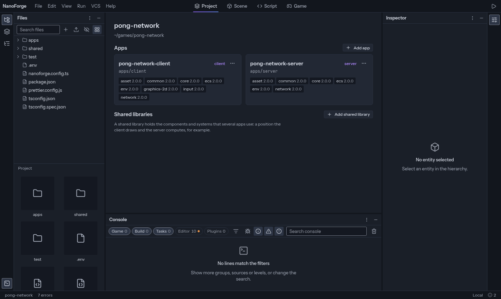

The NanoForge editor is where you build a NanoForge game. It shows the game's files, code, entities, components and systems, and runs the game next to them. It runs in the browser: hosted at [editor.nanoforge.eu](https://editor.nanoforge.eu), or on your machine with `nf editor`.

A NanoForge game is **code**. The editor keeps no scene file of its own. When you add an entity or change a value, it edits your code, and what you write by hand shows in its panels.

## Start here

1. [Create your first project](create-your-first-project), or take the built-in tutorial.
2. [Find your way around](../editor/overview): screens, panels, menus and the command palette.
3. [Entities](../editor/entities): add an entity and change its components.
4. [Play the game](../editor/play): run it, watch it and change it while it runs.

Already have a game made without the editor? See [Bring an existing project](../editor/adapt-a-project).

## Extend the editor

Panels, commands, themes and tools are plugins. To write your own, start with the [plugins overview](../plugins/overview).
